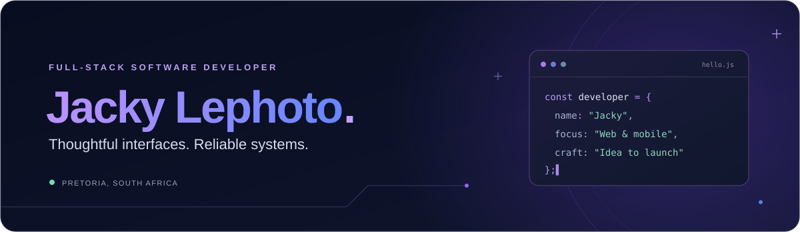

<!-- Profile setup: publish this README and its relative image assets in the public jpitdeveloper/jpitdeveloper repository to show it on the GitHub profile. -->

  

  <strong>I turn ideas into thoughtful web and mobile experiences.</strong> 
  Clean code, considered design, and reliable systems — from the first idea to launch.

  
  
  

---

## A little about me

I’m **Jacky Puso Lephoto**, a full-stack software developer based in **Pretoria, South Africa**. I build websites, mobile experiences, and the APIs and data systems behind them, with a focus on making complex ideas feel simple to use.

- **What I build:** responsive websites, web applications, and mobile experiences.
- **How I work:** thoughtful UI/UX, maintainable code, and care from interface to deployment.
- **What interests me:** AI, robotics, and space — plus music and gaming away from the keyboard.
- **Let’s collaborate:** open to freelance projects and conversations about useful things we can build together.

## The tools behind the work

**Frontend & design**

  
  
  
  
  

**Backend & data**

  
  
  
  
  

**Cloud & workflow**

  
  
  
  
  

Also comfortable with **HTML, CSS, Sass, MySQL, REST APIs, GraphQL, Firebase, Google Cloud, Kubernetes, and Postman**.

## Explore my portfolio

Visit my portfolio to explore my work, services, and the ideas I bring to life.

**[jacky.jpitdev.co.za ↗](https://jacky.jpitdev.co.za/)**

## Let’s build something useful

Have a website, app, or product idea in mind? I’d love to hear what you’re working on.

**[Send me an email](mailto:jacky.lephoto@gmail.com)** · **[Connect on LinkedIn](https://www.linkedin.com/in/jpitdeveloper)** · **[View my portfolio](https://jacky.jpitdev.co.za/)**

---

  Thoughtfully designed. Carefully built. Made in South Africa. 
  <a href="#">Back to top ↑</a>

